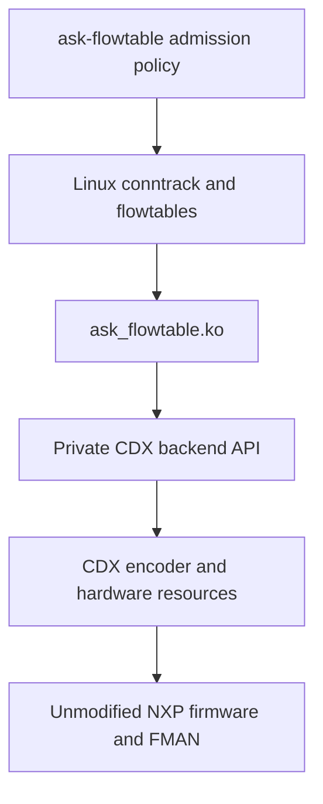

# Linux flowtable architecture

This is the current implementation contract after IPv4 TCP/UDP NAT, including
SNAT, MASQUERADE, DNAT and hairpin/double NAT (2026-09-15). The [project overview](README.md) gives supported
scope and direction; the [history index](history/README.md) retains
earlier designs, superseded restrictions and dated verification evidence.
Update this document when a contract changes, and record the proof separately.

## Components and ownership

Linux owns firewall decisions, conntrack and NAT mappings, routing, neighbours,
flow activity and expiry. The adapter validates native requests and tracks
their dependencies. CDX owns hardware encoding, allocation, retirement and
its failure latch and datapath restart. Firmware forwards admitted packets without invoking
CMM or per-flow FCI commands. CDX builds the classifier during
[module initialization](../in-kernel-pcd.md).

| Responsibility | Source |
| --- | --- |
| Native callback context, shared handles and route integration | [Kernel patch 140](../../patches/kernel/140-ask-flowtable-context.patch) |
| Whether an nftables commit is still being applied, for routed multicast confirmation; whether nf_tables (`nft_port_dependent()`) or iptables-legacy (`nf_xt_port_dependent()`, an ip_tables/ip6_tables walker reached through hooks typed `NF_HOOK_OP_XTABLES` and the NAT core's `NF_HOOK_OP_NAT`) could tell a routed group's streams apart by port; and `net->nf.xt_seq`, the count of x_tables table changes a caller re-asks on | [Kernel patches 139](../../patches/kernel/139-netfilter-nftables-commit-in-progress.patch) and [148](../../patches/kernel/148-netfilter-port-probe.patch) |
| Rule decoding, binding and admission | [ask_flowtable_core.c](../../cdx/ask_flowtable_core.c), sharing state through [ask_flowtable_internal.h](../../cdx/ask_flowtable_internal.h) |
| Dependency watches, invalidation and the egress hook | [ask_flowtable_watch.c](../../cdx/ask_flowtable_watch.c) |
| IPsec packet offload | [ask_flowtable_ipsec.c](../../cdx/ask_flowtable_ipsec.c) |
| Bridged multicast learner | [ask_flowtable_mc.c](../../cdx/ask_flowtable_mc.c), [ask_flowtable_mc_hook.c](../../cdx/ask_flowtable_mc_hook.c) |
| Routed multicast learner | [ask_flowtable_mr.c](../../cdx/ask_flowtable_mr.c), [ask_flowtable_mr_probe.c](../../cdx/ask_flowtable_mr_probe.c) |
| Wi-Fi VAPs | [ask_flowtable_wifi.c](../../cdx/ask_flowtable_wifi.c) |
| QoS classification, `/proc/cdx_flowtable`, module init and exit | [ask_flowtable_main.c](../../cdx/ask_flowtable_main.c) |
| Private source interface | [cdx_flowtable_backend.h](../../cdx/cdx_flowtable_backend.h) |
| Transactions, claim, port checks and fatal guard | [cdx_flowtable_backend.c](../../cdx/cdx_flowtable_backend.c) |
| Independent directional encoding and retirement storage | [cdx_flowtable_hw.c](../../cdx/cdx_flowtable_hw.c) |
| Shared classifier encoder and firmware operations | [cdx_ehash.c](../../cdx/cdx_ehash.c) |
| Physical identity and configuration | [devman.c](../../cdx/devman.c), [dpa_cfg.c](../../cdx/dpa_cfg.c) |
| Admission configuration and revocation | [ask-flowtable](../../flowtable/src/main.c) and [policy guide](policy.md) |

The private interface uses GPL-only exports in `ASK_CDX_FLOWTABLE`. It exposes
typed rules, counters and opaque hardware handles, without CDX control/device
structures or firmware objects. It is maintained with this repository, with no
stable binary ABI promise. The adapter depends on `cdx` and `nf_flow_table`;
CDX has no flowtable-module dependency. Kernel integration targets the pinned
[6.12.112 recipe](../../meta-ask/recipes-kernel/linux/linux-ask_6.12.bb) and SDK source.

## Startup and configuration seal

The flowtable adapter is the only hardware flow owner; there is no boot-time
owner selection. The test initramfs loads CDX and then the adapter. CMM, FCI
and auto_bridge are neither built nor shipped; their source trees remain only
as reference. CDX no longer carries an FCI entry point or command handlers:
the flowtable adapter and the tc, devlink and netdev verbs are its only
control surfaces. `ask.flowtable_observe=1` on the kernel command
line validates requests but declines installation; CDX owns the read-only
`flowtable_observe` module parameter. Module loading is implemented in the test
initramfs; production packaging and persistent deployment remain separate work.

The adapter acquires an exclusive provider claim before publishing callbacks.
Claim is refused while CDX's latch holds (until CDX restarts the datapath,
which it always does in the end), while another claim or live directions
exist, or while retirement is pending. Provider configuration is fixed when
CDX loads: CDX builds the classifier itself, and the userspace SET_PARAMS ioctl
that could once change it is retired and returns `ENOTTY`
(`cdx/cdx_ioctl.h`). Release requires zero live directions; it cannot clear
quarantine or the latch.

## Native context and admission

Every binding that carries hardware flows is a physical CDX Ethernet port in
the initial network namespace. Any other device a table names, such as a VAP
in the LAN bridge, or a port the hardware cannot take for the rest of the
boot, is bound passively: every request is declined and its flows stay on the
software fast path. One flowtable may bind up to 40 hardware ports
(`CDX_FT_MAX_TABLE_DEVICES`, `cdx/cdx_flowtable_backend.h`; passive bindings
are not counted); that matches CDX's physical-port slots and is a
representable bound, not a port count, so on a board the limit is the ports
it actually has. At most two flowtables may be bound at once
(`CDX_FT_MAX_TABLES`): Netfilter binds a replacement table while preparing its
transaction and unbinds the old one only at commit, and a consumer probing for
offload binds a second table beside its own. Two tables may therefore bind
the same device; one table never binds a device twice. The adapter admits at most 32,768 directions, sufficient
for 16,384 fully accelerated connections. This is an admission budget, not a
firmware capacity claim. The [capacity guide](capacity.md) describes
resource reasoning and the focused proof. Directions consume slots independently without eviction.

Binding/cookie and ingress/tuple lookups use separate fixed hash indexes, each
with 16,384 buckets, under the existing backend transaction. Full key comparison
resolves collisions; the tuple hash has a seed chosen at adapter load. Index
publication follows successful hardware installation and index removal shares
the entry's list lifetime. The two dependencies a station can drive from the
LAN at packet rate are indexed the same way: bridge FDB events look up flows by
destination MAC and VID, neighbour updates by neighbour object, so a MAC flood
costs one bucket per learn rather than a walk under the bridge's hash lock.
Administrative notifications (prefix, device, policy, nexthop) still walk the
bounded watch list, because one such change can affect every flow.

Patch 140 supplies borrowed conntrack, both selected destinations, effective
directional MTU and the table's accounting requirement. Context version 5 also
supplies a shared invalidation handle. Cookies are opaque and binding-local;
the adapter never recovers a parent flow through a cookie cast. No borrowed
conntrack or destination pointer survives the callback.

Admission requires exact supported masks and actions and default conntrack
zones. A conntrack mark is admitted only inside the configured QoS
classification mask (`ask_flowtable.qos_mark_mask`, see [QoS](qos.md)) and the
bits an operator names at load as selecting a route only
(`ask_flowtable.route_mark_mask`: mwan3's, pbr's, a VPN client's policy
routing, which Linux resolved when it created the flow). Naming them states
that nothing reads them once the connection exists -- no forward or postrouting
rule, no tc filter, connmark or ctinfo action -- which Linux's own software
flowtable assumes of a flow as well. The two masks may not overlap, and under
an IPsec policy a direction marked outside the class stays in software, since
policy lookup reads each packet's mark. A bit outside both still refuses, and
with neither configured that is every nonzero mark. A table with native `counter` accounting is admitted, and the hardware
traffic is restated into Netfilter's units (see
[statistics](#statistics-diagnostics-and-verification)). Supported packets are
routed unicast IPv4 and IPv6 TCP/UDP, IPv4 TCP/UDP source NAT (static or
MASQUERADE) and destination or combined NAT, and IPv6 source and destination
NAT ([IPv6](ipv6.md), [NAT](nat.md)). TCP additionally
requires an assured, established conntrack and precisely Netfilter's FIN/RST
exclusion. Helpers and sequence-adjusted connections are excluded by native
flowtable eligibility. VLAN, bridge and PPPoE framing, multicast, IPsec,
tunnels and Wi-Fi egress each have their own eligibility contract, linked from
the [overview](README.md); anything without one stays in software.

Rules contain four native Ethernet mangle words and a redirect, with the exact
translation/checksum sequence for admitted [TCP/UDP NAT](nat.md). Bound ports
must be registered physical CDX devices, running with carrier. A logical
ingress or egress above one is admitted only through the composition the
[VLAN](vlan.md) and bridge/PPPoE contracts describe. Ingress and egress must be distinct
except for a completed combined SNAT/DNAT mapping (the hairpin contract). Physical lookup uses the device object,
not its name or a recyclable interface index. The Ethernet source is the
address of the device Linux transmits from -- a bridge, a VLAN device, the
device under a session -- carried in the entry rather than read from the port;
Netfilter's own source words must still name the egress port's **current**
address, or the offer predates a change and is retired. An OS rename preserves
identity and forwarding semantics.

Both borrowed routes are checked under RTNL before insertion. The egress route
must be valid unicast on the selected port, of the flow's own family and
without lightweight tunnel state; an IPv4 route may not use an IPv6 gateway,
and an IPv6 route may not be a reject, local or anycast route. For an
encrypted flow the route judged is the one beneath the transform, which
carries the outer packet ([IPsec](ipsec.md)). The driver uses Linux's selected route rather than
repeating policy routing with incomplete packet context. The route's MTU must be
no greater than the egress device MTU; the effective MTU is the smaller of it
and what the devices below carry -- the physical port, and a session's or
tunnel's lower device, less the headers inserted beneath (`ft_port_mtu()`) --
and must be at least 68. A bridge's MTU may be set above its ports', and Linux
then drops at the port what the port's MTU forbids, so the hardware never sends
it either (A340).

A direction of either family that is neither TCP nor, for IPv4, to or from an
SA is admitted as it is only while nothing larger than its MTU can arrive
(`ft_mtu_carried()`); an IPv4 UDP one is otherwise carried through the
offline-port detour, below. The microcode fragments a packet that exceeds the
entry's MTU -- IPv4 without DF, and any IPv6, which it never hands to Linux --
and for a frame received on an Ethernet port those fragments leave with
correct headers and an all-zero payload, so the receiver discards them; a
6o4 insert's outer IPv4 header carries no DF, so an oversized 6o4 packet goes
the same way. Fragments of the SEC output, which
reaches the classifier through the offline port, are correct. What can arrive
is bounded by the physical port's MAC: patch 109 programs each DPAA port's
max frame from its MTU as `max(mtu, 1500)` plus header and FCS, plus one VLAN
tag while the port has any upper device (a VLAN, a bridge, a bond, a macvlan)
and two once a VLAN on it is 802.1ad or carries a VLAN, so a frame over that
is dropped and counted by the MAC. A direction's bound is therefore
`max(port MTU, 1500)`, less whatever the direction strips (a PPPoE session's
8 bytes, a tunnel's outer header), whatever its logical ingress device says: a
port lowered below 1500 keeps receiving full frames, a 1500 bridge or VLAN
over a 9000 port receives 9000-byte frames from hosts that were never told the
smaller MTU, since DHCP's MTU option is widely ignored and a router
advertisement's can be, and a bridge set to 9000 over a 1500 port receives no
more than the port does (A346). The IPv6 MTU a link advertises is therefore
not the bound either. On such a jumbo trunk every non-TCP direction into a
1500 path stays in software, the offline-port detour below included. The tag allowance lets an untagged frame on a port with uppers
exceed its MTU by four (or eight) bytes; that window is deliberately not
counted, since counting it would refuse every bridged 1500→1500 UDP
direction, and it needs a host sending more than its link's MTU. A TCP direction is
carried into the smaller path: TCP sets DF, the preemptive
`PREEMPT_DFBIT_HONOR` check hands an oversized DF packet to Linux for its
Fragmentation Needed, and one that clamps the MSS rarely sees any. The one
exception, a sender that clears DF on TCP into an unclamped smaller path,
loses those segments and stalls rather than delivering corrupt data, since
the zero payload fails the receiver's checksum. An IPv6 TCP direction has no
DF to fall back on: it rests on the uplink's MSS clamp alone, and a segment
over it from a host that ignores the clamp is lost. That clamp is the one
thing an integration owes the bound (OpenWrt's `mtu_fix` on the WAN zone, on
by default). A refused direction stays on the software flowtable path, where
`ip_forward()` fragments correctly and `ip6_forward()` sends Packet Too Big;
the reverse direction is admitted on its own. Equal MTUs, the ordinary
Ethernet WAN, are unaffected. A smaller upstream is where it shows: IPv6 UDP
leaving a LAN by PPPoE (1492), and UDP of either family into a 6in4 tunnel
(1480) or a 4in6 tunnel (1452), runs in software in that direction, and TCP
and the download direction stay in hardware. Device and route MTU
changes retire installed directions through their events, so the bound is
checked at admission.

### The offline-port detour

IPv4 UDP into a smaller path from a standard port -- every UDP upload into a
PPPoE session from a 1500-byte LAN, QUIC, WireGuard and games among it -- is
carried in hardware
through an offline port, whose microcode fragments whole (`cdx/cdx_detour.c`,
A385). Only an offline port fetches the whole frame before its PCD runs, which
is why the SEC output's fragments were always correct. The direction is
installed as two entries, through `cdx_ft_hw_add()`. The receive port's checks
and counts each frame and enqueues it untouched -- Ethernet header, tags and
session included -- to the queue into `dpa-fman0-oh@4`, the board's third
offline port, which nothing else uses. The offline port classifies it again,
against its own entry for the tuple, keyed with that port's id, and that entry
does what the receive port's otherwise would: the strip, the NAT, the TTL, the
insert, the enqueue to the egress port, fragmenting included. The ingress
policer and the Ethernet receive counters are the receive entry's; everything
else, the session and tag counters with it, is the offline entry's, and the
direction's packet and byte counts are the receive entry's, as it arrived.
`/proc/cdx_flowtable` marks such a direction `detour=1`.

DF is the receive entry's: it carries the path's MTU with `PREEMPT_DFBIT_HONOR`,
so a DF packet the path cannot carry goes to Linux from the port it arrived by,
which answers Fragmentation Needed, and its enqueue fragments nothing
(`FRAG_DISABLE`). A packet without DF is fragmented by the offline port's
fragmenter, two fragments for a 1500-byte packet into a 1200 or 1492 path,
from the fragmenter's own pool.

What the offline port hands back instead of forwarding reaches one of its PCD
queues, the detour queue's context B or the port's default queue -- with
nothing to say which port it came in by. Every detoured direction is recorded
by its tuple for that (`cdx_detour_flow_add()`): the frame, still as it
arrived, is parsed past its tags and session to the tuple, copied, and given to
Linux on the recorded port with `netif_rx()`, as the receive port's own
exception would have been. The record outlives the direction by a tenth of a
second, for the frames still in the port's queue when its entries went, and it
refuses a second direction with the tuple of one already carried, whose
offline entry would collide with that one's: that direction stays in software.
`detour_delivered`, `detour_unknown` (no record), `detour_failed` (not copied)
and `detour_errors` (the port's error queue) count it.

Every queue tail-drops at 128 KiB. A direction offered more than the offline
port forwards -- some 530k 1500-byte packets a second on the DK, fragmented,
6.4 Gbit/s -- loses the excess at the queue into the port; QMan discards an FMan enqueue it rejects and the buffers go back to their
pool, so the ingress port's pool is never held. The detour's only cost is that
throughput bound, well above any PPPoE uplink. A board without the port, an
older device tree, comes up without the detour (`detour 0`) and keeps these
directions in software as before, and so does cdx's `detour` parameter set to
0 at runtime, for what is admitted from then on. The detour takes no tunnel, whose outer
packet the fragmenter would cut, no SA, exempt already, no IPv6, which a
router never fragments, no direction received in a PPPoE session, every
frame of which the offline port handed back when one was tried (A393), and
none from a port whose MTU is above 1500: a jumbo frame arrives in several
buffers, and a line-rate flood of them through the offline port timed out the
FMan's host-command channel (A394). That leaves
a download from a session into a LAN path below 1492, and UDP from a jumbo
LAN into a standard path, in software.

An IPv4 direction into an SA is exempt because its entry is bounded
differently; an IPv6 one is not, because out of SEC the offline port would
fragment the decrypted IPv6 packet itself. The
bound is the bundle's MTU that Linux enforces, the smaller of the SA's MTU on
the path to the peer and the inner route's, with SEC's expansion on top, which
the microcode adds before comparing. `PREEMPT_DFBIT_HONOR` therefore hands
Linux exactly the DF packets Linux would answer, and a packet without DF goes
to SEC whole. A change to that path -- the port's MTU, a route to the peer, a
learned PMTU -- retires the directions the SA encrypts, so readmission reads
the new bound ([ipsec.md](ipsec.md), A227, A230, A231).

A refused direction does not stay refused quietly. Linux offers a flow again
at most about once a second for as long as the software fast path forwards
either direction's packets: `flow_offload_refresh()` queues the whole flow, and
the offload work offers both directions. A direction the MTU bound is certain to refuse is therefore refused
before RTNL is taken, counted as a reject and never as busy, retiring nothing:
anything other than TCP whose path is below the port bound less the most the
ingress device's kind can strip: nothing through an Ethernet device, a
session's 8 bytes through a ppp one, 28 through a sit tunnel and 48 through
any other (a session and a 4in6 outer header). It does
so only while no xfrm policy or blocking default is configured and neither
destination carries a transform, because an SA exempts an IPv4 direction and a
policy denial retires the generation, and only the walk under RTNL finds out
either. Whatever passes is held to the exact bound there. A full table is
refused the same way, before RTNL and counted as a reject, for a direction
software keeps offering; one nothing offers again goes on to admission, where a
hardware key its previous generation still holds retires it before capacity
refuses it (see below).

The selected next hop needs a live ARP neighbour whose MAC matches the rewrite.
PERMANENT, REACHABLE, STALE, DELAY and PROBE are eligible; NOARP, unresolved,
failed and detached neighbours are refused. A neighbour is rechecked and its
watch published before hardware insertion so a racing change forces rollback.
Hardware activity calls Linux's neighbour-use path; it does not confirm
reachability or suppress normal ARP probing.

The table opts into neighbour-aware software output and shared hardware handles.
Those choices persist after unbinding. Concurrently constructed DIRECT flows
are retired so software fallback cannot retain a stale Ethernet rewrite. For
these tables, reverse IPv4 route lookup requires FIB success rather than an
on-link fallback after a failed forced-interface lookup. Ordinary kernel callers
retain their existing behaviour.

TCP admission depends on the deployed [soft parser](../../config/pcd/cdx_sp.xml):
`tcpschema` marks packets with `tcp.flags & 7` for the CPU (`$hpnia`), so a
SYN, FIN or RST that matches an installed flow entry is handed to Linux rather
than carried (a bridged pair carries it, as the bridge would), and one that
misses meets the punt meter like any other exception. CDX adds no
independent TCP sequence/window tracker. Parser or firmware changes require
revalidation of this behaviour.

TCP closure is asynchronous. A final pure ACK can cross hardware before deletion,
and conntrack's saved sequence state can lag offloaded data. Acceptance checks
endpoint closure/reset, Linux visibility of FIN/RST, hardware retirement and
bounded native conntrack expiry; it does not require a particular intermediate
conntrack state label. See the [TCP evidence](history/connections-and-admission.md#tcp-increment-and-validation-2026-09-14).

Packet restrictions must hold for later packets with the same tuple, not just
the admission packet. The existing parser/preemptive checks and Linux fallback
have focused routed-UDP evidence for TTL/MTU exceptions, options and fragments.
Each new feature combination still needs its own exception proof; the first
static TCP/UDP SNAT increment does not establish every NAT exception combination.

## References and directional resources

| Object | Lifetime |
| --- | --- |
| Binding | Owns one ingress-device reference until callback release |
| Installed direction | Owns egress-device, neighbour and shared-handle references |
| Shared invalidation handle | Reference counted; retains no flow, conntrack, route, table or namespace pointer |
| Retained table pointer | Identity only outside the setup callback; setup borrows the live table to check emptiness |
| Hardware owner | CDX retains it until synchronized removal, its datapath restart, or safe teardown |
| Provider module | Pinned by the adapter's imported symbols throughout load, use and exit |

Each hardware match has a private encoding entry, synthetic twin and embedded route.
A 4o6 receive direction owns two matches for its supported outer-header forms.
They never join legacy connection/route hashes, ageing or CMM notification paths.
The hardware match includes the ingress tuple and first-header fields that
distinguish ordinary traffic from a tunnel's outer endpoints and protocol
([tunnels](tunnels.md#the-two-halves)). For NAT the twin is the inverse
translated tuple. The [NAT guide](nat.md#mapping-and-dependencies)
defines mapping validation and dependency addresses.

Netfilter visits every bound device with each offer, counter read and deletion,
and only the direction's ingress can own anything of it. Patch 140 names that
ingress for every command (`nf_ingress_ifindex`, context version 9), so the
other devices answer as finding nothing -- offers declined, no counters, nothing
deleted -- before RTNL or the backend transaction.

A direction reports success only after insertion. An offer for a direction
already installed in the same generation is answered from its entry (below);
one that arrives while a global latch is pending goes through admission, which
takes the entry out if it no longer parses and replaces it if it parses
differently. A conflicting cookie for the same hardware key is refused, as is
a reused cookie with a different shared generation. Capacity or
unsupported-direction refusal can leave the other direction accelerated.
`[HW_OFFLOAD]` is not proof of a pair.

The periodic offer of a partially offloaded flow includes its installed
direction, and that offer is answered from the entry without RTNL or a new
walk. Nothing it describes can differ from what was installed without the
generation being retired first: the rule is built from the flow's tuple,
destinations, session and tunnel records and MTU, all fixed for the
generation, and what those resolve through -- routes, neighbours, device MTU,
address, link and uppers of every device the path names or crosses, bridge
forwarding state, tunnel parameters, egress queues, SAs -- retires it by event.
A fully offloaded flow, which is never offered again, relies on exactly that.
The conntrack mark and a police filter are sampled once at admission, as for
any offloaded flow ([QoS](qos.md)). What no event reports is rechecked on the
offer: the two borrowed routes, as before any parse, and the IPv6 ingress MTU
and bridge output hooks, as on every statistics pass. The policy generation is
not: the offer carries the flow's creation generation. The entry has been
watched since it was published, and from then on a policy change retires it
only if the changed policy's selector can match one of its tuples.
A newly registered bridge `LOCAL_OUT` or `POST_ROUTING` hook retires a
generation with an egress bridge. A pending global latch sends the offer
through admission as before.

An offer that loses `rtnl_trylock()` is declined with `-EAGAIN` and counted as
busy. Where software will offer the direction again it retires nothing: the
fast path forwards the direction and offers the flow again within about a
second, and an installed direction keeps its hardware entry. Two kinds of
direction are never offered again by their own traffic, and for those the busy
generation is invalidated instead, so that native GC and fresh traffic retry
both directions through the same table -- otherwise an installed sibling, whose
own traffic no longer reaches software, would keep the partial pair alive from
hardware statistics indefinitely:

- every direction while an xfrm policy or blocking default is configured, since
  the flowtable hook then hands every packet of a table with hardware handles
  to the normal stack, which never offers an existing flow again;
- a direction arriving through a tunnel (4in6, 6in4), whose tuple names the
  port below the tunnel, where the fast path sees only the outer packet and
  cannot parse it.

Visits to the other bound ports' callbacks, which native work makes for every
direction, are neither refusals nor RTNL users: they are answered first,
counted nowhere, and cannot invalidate a successfully installed direction.

Two more refusals clear by themselves and are retried by retiring only that
generation. Admission allocation failures do so whatever the direction:
adapter entry and hardware-owner `-ENOMEM`, and genuine native admission
work/rule/action allocation failures, invalidate the opted-in generation,
because memory pressure is when a retry a second later is least likely, and
where nothing offers the direction again hardware activity in its installed
sibling would keep the partial pair alive. A hardware key still held by
another generation of the same connection (`-EEXIST`, whose removal Linux
queues on a different workqueue from the new offer and completes within a GC
pass) retires the generation only for a direction nothing offers again.
Capacity (`-ENOSPC`) does not: a readmission would compete for the same full
table, and the installed direction is worth more than a flow churning through
it. Nor does a neighbour the adapter cannot use. For a routed direction Linux
builds neither direction's rule unless that neighbour is valid, so what reaches
the adapter is a change racing the offer or a state it never accepts, and
retiring on the latter would readmit forever. A tunnel's egress is the
exception, because Linux resolves only the tunnel device's own NOARP neighbour
and never the outer next hop the adapter checks: an outer neighbour still
resolving waits for the next offer, and one that resolved to another address
than the walk recorded at flow creation is stale for the whole generation and
retires it (`-ESTALE`, as a changed source address does;
[tunnels](tunnels.md#what-stands-in-for-the-neighbour)). Native work already pending and failed
statistics/deletion work allocations retain their normal semantics;
unsupported match/action construction is not treated as memory pressure.
See the [failslab recovery contract](resilience.md#allocation-failure-recovery--2026-09-21).

## Execution contexts and lock ordering

Backend begin/end transactions use the CDX control mutex to serialize hardware
operations and adapter state. Backend calls never call back into the adapter.
Native rule callbacks run in workqueue context; binding release runs after the
flow block excludes callbacks.

The required ordering and wait boundaries are:

- Indirect UNBIND takes the flowtable write lock before a backend transaction,
  protecting the callback-list move as well as Netfilter's later free.
- Admission and fatal recovery try RTNL inside a transaction. They never wait
  for RTNL while holding that transaction; RTNL holders can flush native work
  whose callbacks need the same control mutex.
- Configuration and final CDX shutdown acquire RTNL and try the control mutex.
  On contention they drop RTNL, wait for and release the mutex, then retry.
  Shutdown stops its timer before releasing both locks between cleanup retries.
- Netfilter work flushes always happen outside a backend transaction.
- Notifiers inspect immutable dependencies under `ft_watch_lock`, latch
  invalidation and queue work. They never start a backend transaction.
- Neighbour callbacks nest `ft_watch_lock` inside the neighbour lock. No path
  takes a neighbour lock or begins a transaction while holding the watch lock.

Binding and dependency publication/removal follow this same exclusion. An empty
binding still watches its device, and installed egress dependencies are watched
even if that device has no ingress binding. Unrelated devices are ignored.

## Dependency retirement and recovery

Selective retirement invalidates a shared handle, stopping Linux's cached lookup
immediately. Hardware retirement is asynchronous; native GC removes the obsolete
generation and fresh traffic can be admitted after resolution. Cause counters
count newly invalidated generations once per handle, not directions; concurrent
causes can coalesce. Hardware retirement errors escalate to global recovery.

| Change | Scope and recovery |
| --- | --- |
| Neighbour MAC, unusable state or object detachment | Retire dependent generations; ordinary resolution permits fresh admission |
| Committed IPv4 route prefix | Retire generations using the prefix; fresh route lookup permits readmission |
| MTU, going down, carrier loss or MAC change | Retire generations using the device on either side: physical or logical (VLAN, bridge, ppp, tunnel), or one the path crosses without naming it (a VLAN device under a session, a tunnel or another tag, the ppp device under a tunnel), each held while the direction is installed; current port/route state gates readmission |
| Unregistration of a device that is neither bound nor any direction's port -- a VLAN device, bridge, ppp or tunnel device, named or only crossed | Retire the generations using it, leaving bindings and admission up, whether or not a route retirement got there first |
| Upper-device change on a device paths only cross | Retire the generations crossing it |
| Built-in FIB nexthop ADD/DEL during device/address synchronization | Retire all installed generations conservatively, preserving bindings |
| Bridge FDB entry moved, aged out or deleted for a flow's destination MAC | Retire generations pinned to that entry; relearning permits readmission |
| Bridge per-port VLAN membership add or delete | Stop admission globally; recreate the table after configuration settles |
| Rename or same-MAC usable NUD progress | Preserve valid entries |
| Routing policy, nexthop-object mutation, a port's unregistration, or an upper-device change on a port or on a device a flow names | Stop admission globally; recreate the table after configuration settles |
| Nexthop-object statistics query or notifier registration dump without bindings | No invalidation |

Route-prefix events cover every committed IPv4 alias insertion, replacement,
deletion and flush; selected-alias FIB notifications can precede commit and are
not the retirement source. Identical replacements and failed insertions emit no
committed event. Watches check the translated destination and match source,
covering both routed endpoints even if only one direction installed. All tables
and DSCP aliases are matched conservatively. Both borrowed destinations are
revalidated under RTNL to exclude stale queued work. Native route generation and
expiry checks remain in effect for software caches.

Global invalidation retires hardware, resolves pending barriers, flushes native
flowtable work outside the transaction, then publishes `invalidation_done` as
its final state change. This is distinct from selective generation retirement.
An unproven hardware unlink also latches the provider's failure, which takes the
classifier out of the datapath -- the ports forwarding in software -- until CDX
has settled the key and restarted it (see [Datapath restart](#datapath-restart)).

Healthy global recovery requires zero old bindings, entries, handle/neighbour
references and retirement quarantine, and completed invalidation work. A binding
made while an invalidation is latched is parked rather than refused: it counts
in `bindings` and `parked` and declines every flow, so the consumer's
transaction commits with its flows in software. Recovery makes every parked
binding live, clears the invalidation and increments `rearms`, in the same
backend transaction as the event that completed it: the release of the last old
binding (an atomic reload's commit), the worker publishing `invalidation_done`,
or the parking bind itself when nothing is left to wait for. While only an
unproven deletion remains, the parked binding retries that barrier every second.
A global event raised while anything is parked, or a parking bind into a table
that already holds flows, is counted and needs a further worker pass: a parked
table's software flows are flushed before it goes live. Netfilter's refresh
offers the parked tables' flows again, so they enter hardware with no reload. `rearm_ready=1` reports eligibility; failure to
allocate a binding neither parks nor rearms. Counters remain cumulative. The
first binding after a full detach still requires an empty candidate flowtable: a
table whose hooks were detached can still contain cached flows, so pointer
identity or reattachment alone is insufficient. Binding never waits for the
worker while holding Netfilter locks. No adapter recovery operation clears
CDX's latch: only CDX's own datapath restart does, and it then asks the adapter
to rearm. While CDX is restarting, however long that takes, a bind is made as
usual and declines every flow; past the binding bound a bind is accepted
passively (`passive`) so the transaction still commits.

## Hardware deletion and shutdown

| Deletion outcome | Required action |
| --- | --- |
| Unlinked and synchronized | Free hardware and its owner |
| Unlinked, barrier unproven | Retain existing owner/storage; retry the barrier without another destructive unlink |
| Unlink unproven | Latch the failure; record the possibly linked storage; stop every classifier port until it is idle and send it past the classifier, so the datapath forwards in software; with nothing walking the tables, settle it and give the classifier back -- retrying whatever that waits for, in software, for as long as it takes |

Every result consumes the adapter's hardware handle. A null handle is not proof
of retirement. The failure path uses the already allocated backend owner and
requires no allocation. CDX accounts for pending retirement after adapter claim
release and refuses a new claim while it remains unsafe.

A delete's own barrier is a host-command round trip, about two thirds of what a
delete costs. Retiring a full table one synchronized delete at a time held the
control mutex for 13 s on the KASAN image, and readers, admission and Linux's
callbacks queued behind it (A327). So the adapter unlinks without the barrier
(`cdx_ft_unlink()`) and asks for one barrier per batch (`cdx_ft_settle()`). An
owed unlink is the "barrier unproven" outcome before any barrier has been
asked of it. Every walk that retires many entries goes in batches of at most 64
and settles each batch before it lets the transaction go: the retirement worker,
a binding's release, global invalidation, an SA's retirement and a Wi-Fi VAP's
drain. Linux's own deletions arrive one flow per callback. Each leaves its
barrier owed, the 64th owed one settles inline, and a queued settle takes the
tail of a burst. Admission settles anything owed before it asks the backend. A
failed settle counts as one failed deletion: its owed entries become ordinary
unproven retirements, and global recovery takes over. Displaced cumulative nodes
go back to their own table's spare, whichever table the barrier went through.
`/proc/cdx_flowtable` reports owed unlinks as `owed`, separately from
`quarantine`.

The multicast learners retire groups the same way, 16 to a hold
(`FT_MC_RETIRE_BATCH`): a group's delete is its root and its listener chain,
about 18 ms on the KASAN image, and a family's 512 retired in one hold kept
/proc and the health probe waiting 9.5 s (A312). Between their batches they let
the transaction go until nobody waiting for it is left, up to 100 ms
(`cdx_ft_let_waiters()`): a released mutex wakes one waiter while the releasing
job takes it back, so batches alone let one waiter through each. And
/proc/cdx_flowtable sizes its buffer for the header when it is opened, so the
header renders in one hold rather than once more at every doubling of seq_file's
buffer. The health probe reads it only as far as the counters: each buffer of
the rows after them would be a hold of its own.

Pending retirement includes entries CDX parked for its own paths: a multicast
group delete or listener swap, or an IPsec SA delete, whose barrier failed. The
backend refuses a claim and every new entry while any remain. One completed
barrier proves every unlink before it, because the SoC runs a single FMan PCD.
So a successful backend delete, or a backend retry through either list,
releases the backend's retired entries and CDX's parked ones together; CDX's
own barriers release only its own. The waiters retry that barrier
themselves: a claim once per attempt, admission at most once a second, the
unload loop and invalidation worker on each pass, and a parked binding every
second. A parked backlog therefore no longer waits for an unrelated delete of
the same kind. A key that may still be linked is never released by a barrier.
Inside the table API the same rule covers the cumulative nodes of a colliding
bucket. A node that a delete or an add displaced while its sync failed is
parked there, and the first later sync on the PCD that completes frees it.

### Datapath restart

Possibly linked storage must not be freed into a live hardware hash chain --
but once no port walks the tables, nothing is live to free it into. Stopping
the classifier ports would make that so, and forward nothing at all, not even
in software, for as long as the doubt lasted. So the restart stops the ports
only for as long as it takes to see them idle, and then sends them past the
classifier: each keeps its PCD, its frames go straight to its default queue
(`FM_PORT_BypassPCD()`), and the ports run again, every frame going to Linux.
The datapath forwards in software from then on until the classifier is back,
and nothing about an episode is ever left for a reboot: whatever it waits for
is retried for as long as it takes. The restart runs from the latch's own work,
and the adapter's recovery drives the same restart at the same pace; each
attempt takes RTNL by trying, for the one transition it makes, and never holds
it across a wait.

**Stop and bypass.** The stop disables every classifier port (Rx and offline)
behind a fence in the SDK that refuses every other enable, and waits until the
registers report none still finishing a frame; it never detaches a port or
drains a queue. A provider `NETDEV_PRE_UP` guard refuses a port's open while the
ports are stopped; the guard survives adapter removal. The stop also proves
that no other port reaches a classifier, and the host-command port, which no
PCD can be set on, stays up to carry the barriers. Each port then goes past its
classifier while disabled, and they start again as a resume would start them
(an Rx port only if its netdev, in whatever namespace, is still up), with the
fence off: a netdev opening its port meanwhile opens it as usual, past the
classifier like the rest. The kernel log says `classifier bypassed after
unproven deletion` once an episode, and `/proc/cdx_flowtable` reports
`bypassed 1`. A port still busy is asked again a quarter second apart, the
ports stopped meanwhile, for as long as the hardware's own answers take when it
is well -- twelve tries, a few seconds; then every port is bypassed anyway. Its
frame may still walk the tables, so nothing it let go of is freed until a later
look -- that port alone stopped again, briefly, backing off -- finds it idle. A
port the SDK will not switch stays stopped, named once, and is tried again
every attempt; it walks nothing, so the episode goes on without it. Its
netdev's open is refused meanwhile, as every port's is during the stop, with
the same log line; the fence would refuse it anyway, with an SDK error code in
place of an errno and nothing logged.

**Settle.** With every port idle and past the classifier, no port CDX did not
configure reaching one (checked on every attempt: while such a port does,
nothing whose key may still be linked is freed -- it is kept, with the records
and policer it names, out of what the adapter's retirements wait on -- and the
attempt backs off), and a barrier completed behind the
last frame the ports let go of, nothing walks the tables. Retired entries are
freed, or, when their key may still be linked, recorded; every recorded key --
a flow's, a multicast group's with its listener chain behind it, an SA's -- is
looked up in its table and deleted again, or freed when no bucket links it.
Every arm of the table's delete that fails does so before changing anything, so
such a key is linked where it was or nowhere. A record is carried by the key's
own `hw_ct`, so recording one never needs memory. A second barrier then
releases everything parked. A barrier the host-command channel refuses -- a
command that timed out shuts it until the FMan answers it, A401 --, a key the
table still refuses, a malformed table or a key refused eight times (both then
retried only at the longest interval), the test image's
`flowtable_restart_hold`: each is retried, backing off to thirty seconds, for
as long as it takes, the datapath in software throughout. The settle runs again
on every attempt until the classifier is back, so what is retired meanwhile is
settled too.

**Restore.** No more than `flowtable_restart_limit` restarts (three by
default) complete within ten minutes, counted from the first; one past it is
settled but waits in software until the window allows another, and at a limit
of zero until the limit is raised, which a write to the parameter makes CDX
notice at once. Under one RTNL hold the ports then stop again, take their PCD
back unchanged, FQIDs held for a deleted SA go back, an SA stranded by the
failed delete gets its entry again, the latch clears, and the ports start as
the first stop found them -- or as their netdevs left them since. A port that
would not go idle for that, or would not take its PCD back, leaves them all in
software, asked again later. The adapter is then told: both multicast learners
reconsider their groups, every SA has its peer resolved again, and a parked
binding rearms. Live entries are never touched. The kernel log records
`datapath restarted after unproven deletion` with what it settled, how long
the ports were stopped and how long bypassed, and `/proc/cdx_flowtable` counts
`restarts`. A port the restart cannot start again is named in the log and
counted in `resume_failures`; the latch stays clear, since the tables are
settled. A receive port starts again with its netdev; an offline port, which
has none, only when CDX is reloaded or the board reboots.

Whatever an episode waits for is published in
`/sys/module/cdx/parameters/flowtable_degraded_reason` while it waits, and once
the episode has lasted thirty seconds the log says once for each reason that
the restart has stalled, and why. The platform's health probe passes
throughout: a datapath forwarding in software is a healthy one. While bypassed,
the offline ports send their frames to their default queues, so IPsec offload,
Wi-Fi offload and the detour carry nothing; Linux's own paths carry what they
can, and the restore installs the offloaded SAs again. Full provider teardown
still detaches the classifier -- which also ends a bypass -- and permits
software port operation again, restoring each port as the stop found it (an Rx
port only if its netdev is still up), and settles a recorded key only when no
other port reaches a classifier. That teardown -- `rmmod cdx`, a path the test
image exercises and production never takes -- waits for every classifier port
to report itself idle before it detaches one, retrying once a second.

Adapter exit invalidates its shared handles, removes procfs/notifiers, cancels
work, unregisters indirect callbacks and completes safe hardware retirement
before releasing the claim. Retries release the transaction between attempts;
unload can wait indefinitely when safety cannot be proved. Normal module
references prevent CDX unload while the adapter is loaded.

Healthy reload preserves provider configuration and owner. Existing nftables
flowtables continue in software; recreate the table to bind the new adapter.
Adapter counters reset on reload, while the provider seal persists, and so does
CDX's latch until CDX restarts the datapath: a load meanwhile is refused.
The multicast switch (the adapter's `multicast` parameter) comes back on, so a
service that was stopped or paused has to stop again; see the
[policy guide](policy.md).
Actual physical-driver removal additionally needs full CDX teardown to release
its configuration/queue pins. Drain the table, unload the adapter and any other
dependent modules, unload CDX, then unbind the physical driver. Do not force
removal or release references while hardware still uses the device.

## Statistics, diagnostics and verification

`/proc/cdx_flowtable` streams its header and flow rows through `seq_file`, so
reading policy status does not require rendering the entire table. Paged
iteration resumes by hash bucket and offset, without retaining an entry pointer
between transactions or rescanning all preceding entries. Policy
commands stop reading at the first flow row. Each iterator invocation holds the
backend transaction; separate reads of a changing table are not an atomic
snapshot. Diagnostics consumers must allow for several megabytes at capacity.

Hardware packet/byte counters are monotonic 64-bit classifier-hit totals. Bytes
include Ethernet headers and minimum padding but exclude FCS: a 256-byte UDP
payload accounts for 298 bytes, and an 8-byte payload for 60 bytes. Later punts,
including TTL/MTU exceptions, can already have incremented these counters.

Callbacks use deltas; a backwards sample triggers invalidation rather than
unsigned underflow. Firmware timestamps use 32-bit CDX jiffies, expanded relative
to current kernel time; supported idle intervals must stay below half that
clock's range. Linux owns activity refresh and expiry.

Linux asks for the counters once a tenth of the offload timeout has passed
without the flow being refreshed, and (patch 140) once that long has passed
since it last asked for a flow with any direction in hardware. The second
clause is what reaches a partially offloaded flow: software refreshes its
timeout on every packet of the software half, so the first alone never came
due, and the installed half's bytes reached conntrack -- and the statistics
pass's neighbour keepalive its neighbour -- only once software fell silent.
A fully offloaded flow is asked at the same pace as before, and since the
callback reports deltas, nothing is counted twice.

Counter-enabled hardware tables are admitted, and a reported delta is restated
in the units Netfilter counts in. The two counters disagree about framing, not
about packets: a classifier hit counts the frame as it arrived, while
`nf_ct_acct_update()` in the software fast path counts `skb->len` after
`nf_flow_encap_pop()` has removed the Ethernet header, every tag above it and
any PPPoE session header. `ft_l2_overhead()` subtracts exactly that stack, taken
from the direction's own ingress framing, and saturates at zero rather than
wrapping when a delta cannot carry it.

A flow's last delta goes with its teardown. Linux's deletion (patch 140) reads
stats back from `FLOW_CLS_DESTROY` as from `FLOW_CLS_STATS` and folds them into
the conntrack the same way -- in 64 bits, since a read every few seconds
exceeds 32 bits on one flow above eight gigabits per second -- and the adapter
answers it with what the entry counted since its last report, which the
backend reads once the entry's pieces are unlinked (`cdx_ft_unlink()`'s
`final`). A retirement the adapter starts itself -- a dependency change, a
global invalidation, an SA or a VAP going, an offer that found the generation
changed -- reads the entry the same way and holds the delta, keyed by binding,
cookie and the generation's handle (`struct ft_final`), for the deletion Linux
sends once its collector has retired the generation, or for the offer that
readmits the generation first, which carries it into the new entry's next
report. Unbinding a device's block tears the device's flows down through the
still-bound driver first, as the indirect cleanup always did, so a deleted
table reports its flows' last counts too: nftables unbinds the hooks before it
frees the table's flows. `/proc/cdx_flowtable` shows `finals_held`, the deltas
waiting for their deletion, and `finals_dropped`, those no deletion could take.

Per-interface counters are a separate set of firmware records, folded into a
port's or a VLAN device's `rtnl_link_stats64` by the `dev_get_stats()` hook and
restated the same way into that device's units; the
[interface counters guide](statistics.md) has the records, the
measured framing and the lifetime rules.

The residuals, each bounded:

- **Padding.** A frame below the sixty-byte minimum was padded before it was
  counted, and padding is invisible in an aggregate. A flow of minimum-size
  frames — pure TCP acknowledgements, small RTP — reads high by at most ten
  bytes per frame.
- **Punts.** A frame punted after its hit was counted here is counted again by
  the path that handled it. That is bounded by exception traffic (TTL, MTU,
  TCP state), which is zero on a healthy flow.
- **The read after the unlink.** The final counters are read once the entry's
  pieces are unlinked, not after the barrier that proves the firmware has left
  them: a frame whose classifier walk began before the unlink is counted after
  the read, and that count is lost. Waiting for the barrier would cost every
  deletion the host-command round trip batched retirement exists to avoid.
- **Deletions with no taker.** A deletion that found the transaction held is
  answered at once (`destroy_deferrals`), so what its entry counted since its
  last report has no one to report to and is dropped; so is a delta held for a
  binding Netfilter releases before the deletion that would take it -- a flow
  whose deletion could not be queued behind a read in flight when the device's
  flows were swept -- and one no record could be allocated for. All are counted
  in `finals_dropped` (ISSUES A407). A conntrack killed first -- `conntrack -F`,
  a ctnetlink delete -- has sent its destroy event before the flow's deletion
  folds the last delta, so that delta reaches a counter nothing reads again.

This was previously resolved the other way: counter-enabled tables were refused
outright and enabling counters on a live table invalidated it. That refused
every flow under the configuration consumers actually ship — OpenWrt's firewall
renders `counter` on every flowtable unconditionally — to avoid a per-frame
constant that is arithmetic rather than unknowable. `/proc/cdx_flowtable`
continues to expose the raw hardware counters, so diagnostics still see what
the classifier saw.

`/proc/cdx_flowtable` exposes entries, tuple rewrites, raw counters, references,
invalidation causes, quarantine and recovery state. Preserve it before unload
when per-instance diagnostics matter. The test build's one-shot add fault stages
are 1 before allocation, 2 before hardware, 3 after hardware with rollback, and
4 matching contention after the peer direction installs. Load-only initialization
stages are 1 procfs, 2 netdev, 3 neighbour, 4 FIB, 5 indirect registration,
6 nexthop-object registration, 7 bridge FDB and 8 bridge VLAN objects. The provider's test-only unlink fault leaves a
real key linked; CDX restarts the datapath after it, and the test-only
`flowtable_restart_hold` keeps the classifier bypassed, with the key recorded,
for inspection, until it is cleared.

Verification combines production-code host checks, relevant KASAN/lockdep DUT
tests, exact endpoint delivery and independent hardware/software counters. SDK
netdev totals include hardware traffic, and software RX alone can miss a GRO-
disabled flowtable-consumed packet; use software TX enqueue counts and endpoint
captures to distinguish execution paths. Flags, throughput and CPU usage alone
do not prove offload. The [foundation](foundation.md#acceptance-and-limits)
and [NAT](nat.md#focused-verification) guides define the accepted limits
and focused commands. Measured results belong in [history](history/README.md).
